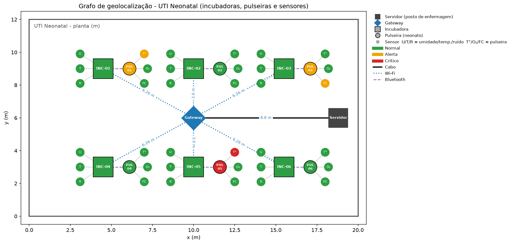

# grafos

Grafo de **geolocalização** da UTI Neonatal do projeto de monitoramento de incubadoras e neonatos.

O script monta, com **NetworkX**, um grafo em que cada nó é um elemento físico da UTI (servidor, gateway, incubadoras, pulseiras e sensores) posicionado na **planta da sala, em metros**. As arestas são as conexões de dados entre esses elementos. O desenho é feito com **Matplotlib**.



## Como executar

```bash
pip install -r requirements.txt
python grafo_uti.py
```

Saídas:
- `grafo_uti.png`: imagem do grafo (também abre numa janela);
- um relatório no terminal com a visão de cada persona.

> Os valores dos sensores são **simulados** com semente fixa (`SEED = 42`), então toda execução gera o mesmo resultado. Mude a semente para ver outros cenários.

---

## O que é o grafo

| Elemento | Tipo de nó | Formato no desenho |
|---|---|---|
| Servidor (posto de enfermagem) | `servidor` | quadrado cinza escuro |
| Gateway da UTI | `gateway` | losango azul |
| Incubadora (`INC-01` … `INC-06`) | `incubadora` | quadrado grande |
| Pulseira do neonato (`PUL-01` … `PUL-06`) | `pulseira` | círculo médio |
| Sensores | `sensor` | círculo pequeno |

**Sensores da incubadora:** `U` umidade (%), `T` temperatura do ar (°C), `R` ruído (dB).
**Sensores da pulseira:** `T°` temperatura corporal (°C), `O₂` saturação de oxigênio (%), `FC` frequência cardíaca (bpm).

### Arestas (conexões)

| Conexão | Liga | Estilo |
|---|---|---|
| `interna` | sensor → incubadora/pulseira | linha fina cinza |
| `bluetooth` | pulseira → incubadora | tracejada roxa |
| `wifi` | incubadora → gateway | pontilhada azul |
| `cabo` | gateway → servidor | linha grossa preta |

Toda aresta tem o atributo **`peso` = distância em metros** entre os dois nós (distância euclidiana entre as coordenadas da planta). É isso que torna o grafo de geolocalização: a posição dos nós e o peso das arestas são grandezas físicas.

### Cores (status)

- 🟩 **Normal**: dentro da faixa de referência
- 🟧 **Alerta**: fora da faixa, mas dentro da tolerância
- 🟥 **Crítico**: além da tolerância

Incubadoras e pulseiras recebem o **pior status entre os seus sensores**. Basta olhar o nó grande para saber se algo ali precisa de atenção.

| Sensor | Faixa normal | Tolerância (alerta) |
|---|---|---|
| Umidade | 50 – 80 % | ± 5 % |
| Temperatura incubadora | 36,0 – 37,5 °C | ± 0,5 °C |
| Ruído | até 45 dB | + 10 dB |
| Temperatura corporal | 36,5 – 37,5 °C | ± 0,5 °C |
| SpO₂ | 90 – 100 % | − 5 % |
| Frequência cardíaca | 100 – 160 bpm | ± 20 bpm |

> As faixas são valores de referência usados para a simulação acadêmica e não substituem protocolos clínicos.

---

## Por que esse modelo (motivo da escolha)

**Um grafo só, para as três personas.** O mesmo grafo responde às perguntas de cada uma:

| Persona | Pergunta | Como o grafo responde |
|---|---|---|
| **Mariana** (enfermeira, near real time) | Qual bebê ou incubadora precisa de mim agora, e onde fica? | Cores de status nos nós, já posicionados na planta. O relatório lista as leituras fora da faixa, das críticas para as de alerta. |
| **Dr. Rafael** (neonatologista, histórico) | As condições do bebê se relacionam com as da incubadora? | A aresta `pulseira ↔ incubadora` liga o neonato ao seu ambiente. O relatório mostra as leituras dos dois lado a lado, que é a base para comparar tendências ao longo do tempo. |
| **Alice** (gestora, infraestrutura) | A rede da UTI está saudável? Onde está o ponto fraco? | Conectividade (`is_connected`), caminho e distância de cada incubadora até o servidor (`shortest_path` com peso), grau do gateway e detecção de **ponto único de falha** (`articulation_points`). |

**Por que NetworkX + Matplotlib:**
- NetworkX já tem os algoritmos de grafos (caminho mínimo, conectividade, pontos de articulação) e guarda atributos em nós e arestas (posição, valor, status, distância);
- Matplotlib desenha usando as **coordenadas reais** (`pos`) em vez de um layout automático, o que mantém o sentido de geolocalização;
- as duas bibliotecas são leves e não precisam de mapa externo ou internet.

**Por que essa topologia (estrela hierárquica):** é como a UTI funciona de verdade. Os sensores ficam na incubadora ou na pulseira, a pulseira fala com a incubadora por Bluetooth, as incubadoras mandam os dados ao gateway por Wi-Fi e o gateway envia ao servidor por cabo. Isso gera uma **árvore** (50 nós, 49 arestas, sem ciclos). Por isso o gateway aparece como ponto único de falha, uma informação útil para a Alice.

---

## Explicação do código (`grafo_uti.py`)

### Configuração
- `FAIXAS`: para cada sensor, a faixa normal, a tolerância e a unidade.
- `SENSORES_INCUBADORA` / `SENSORES_PULSEIRA`: quais sensores ficam em cada dispositivo.
- `CORES_STATUS` / `PRIORIDADE_STATUS`: cor e "gravidade" de cada status.

### Funções auxiliares
- `classificar(sensor, valor)`: devolve `normal`, `alerta` ou `critico`.
- `simular_leitura(sensor, rng)`: gera um valor (80% normal, 13% alerta, 7% crítico).
- `pior_status(statuses)`: escolhe o status mais grave.
- `distancia(a, b)`: distância euclidiana, usada como peso da aresta.

### `montar_grafo()`
1. Cria `Servidor` e `Gateway` e os liga por `cabo`.
2. Para cada uma das 6 incubadoras (duas fileiras de 3 na planta):
   - adiciona a incubadora e a liga ao gateway (`wifi`);
   - adiciona a pulseira ao lado e a liga à incubadora (`bluetooth`);
   - adiciona os 3 sensores da incubadora e os 3 da pulseira em volta delas (`adicionar_sensor`), cada um com valor simulado, unidade e status.
3. Calcula o status de cada incubadora e pulseira a partir dos seus sensores.
4. Calcula o `peso` (metros) de todas as arestas.

### `imprimir_relatorio(G)`
Imprime um bloco por persona:
- **Mariana**: sensores fora da faixa, ordenados por gravidade;
- **Dr. Rafael**: leituras da incubadora ↔ leituras do neonato;
- **Alice**: status, caminho e distância até o servidor, grau do gateway e impacto se o gateway cair.

### `desenhar_grafo(G)`
- desenha o contorno da planta (20 m × 12 m);
- desenha as arestas por tipo de conexão, com estilos diferentes, e o rótulo de distância nas conexões Wi-Fi e cabo;
- desenha os nós com formato por tipo e cor por status;
- adiciona a legenda e salva em `grafo_uti.png`.

### Como adaptar
- **Mais incubadoras ou outra planta:** edite `posicoes_incubadoras` e `LARGURA_UTI` / `ALTURA_UTI`.
- **Dados reais:** troque `simular_leitura` pela leitura do banco ou da API dos sensores; o resto do código continua igual.
- **Redundância de rede:** adicione um segundo gateway e ligue as incubadoras aos dois. O relatório vai deixar de apontar ponto único de falha.
